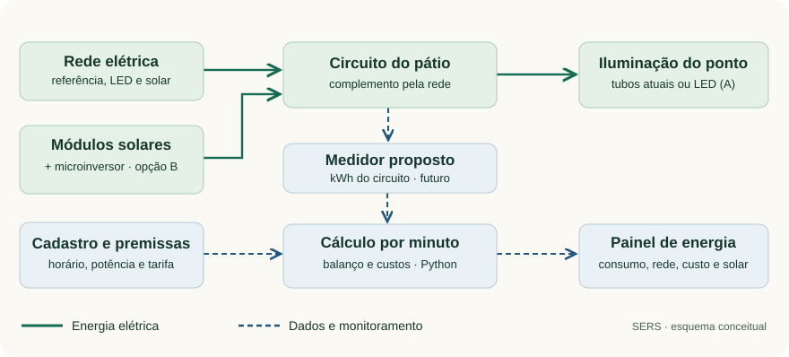

# Pingo de Volta · Energia no Ponto do Tear

**FIAP · Global Solution 2026.2 · Ciência da Computação · Soluções em Energias Renováveis e Sustentáveis (SERS)**

| Identificação da equipe | Informação |
|---|---|
| Turma | 1CCPB |
| Integrante 1 | João Pedro Godoy — RM 575698 |
| Integrante 2 | Pedro Pimenta — RM 575312 |

**Decisão para o responsável pelo pátio.** Priorizar um piloto de troca por LED e medir a luz na rampa e no coletor antes de comprar o lote. No cenário central, a troca atende ao mesmo horário, reduz em 60% o uso final e custa R$ 583,92 para implantar. A geração solar mantém os tubos atuais e oferece outra vantagem, atender parte da carga com uma fonte renovável. Todas as comparações são projeções de um circuito fictício.

## Abrir e reproduzir

1. Baixe ou extraia o repositório. Abra **index.html** no navegador. A página **Visão geral → Comparar alternativas** abre a seção Energia. As abas permitem voltar à ficha ou consultar o método. O arquivo funciona offline por duplo clique.
2. Para recalcular, abra um terminal na pasta que contém este README. Execute `python calcular.py` (Windows também aceita `py calcular.py`; no Linux, `python3 calcular.py`). Requer Python 3.9+ com biblioteca padrão. O comando regenera o JSON, a tabela abaixo e o HTML completo. Reabra ou atualize o navegador.
3. Para verificar, execute `python verificar.py`. Os testes incluem balanço de energia, cálculo independente, sensibilidade, coerência do HTML e um teste didático separado.
4. Para demonstrar, use **Energia → A · Troca por LED → B · Geração solar → Método e fontes**. Em GitHub, baixe o repositório para abrir o HTML. O visualizador de código do GitHub mostra o texto do arquivo.

| Evidência | Onde encontrar |
|---|---|
| Diagnóstico, inventário, decisão e limites | Este README e [memória de cálculo](docs/analise.md) |
| Dados de entrada, fontes e recorte do serviço | [Premissas](dados/premissas.csv), [referências](dados/fontes.csv), [Ponto do Tear](dados/ponto_tear.json) |
| Cálculos, resultados e testes | [Script](calcular.py), [saída JSON](dados/resultados.json), [verificação](verificar.py) |
| Diagrama | [Esquema de energia e dados](docs/diagrama.svg) |
| Painel e integração | [Página inicial](index.html), seção **Energia**, [contrato e fichas dos indicadores](docs/indicadores.md) |
| Cobertura do PDF | [Matriz de conferência](docs/rubrica.md) |

## Que problema queremos resolver?

O **Ponto do Tear**, FZC-001, é um ponto de recebimento de óleo de cozinha usado em garrafas fechadas, na Vila do Tear, município fictício de Várzea do Lume. O cadastro simulado do integrador o descreve como ativo, acessível, com atendimento entre 06h e 23h. Um relato do próprio cadastro menciona uma rampa. Esses dados foram preservados em um recorte JSON. Não há fatura, contagem de visitantes nem medição de luz ou energia fornecidas pelo grupo.

O estudo considera a hipótese de um pátio coberto com lâmpadas acesas durante todo o atendimento. A necessidade é permitir que moradores, inclusive quem utiliza a rampa ou chega após o pôr do sol, encontrem o coletor e leiam as instruções durante as mesmas 17 horas. O responsável pelo pátio acompanha os kWh e o orçamento. A implantação depende de manter a qualidade da iluminação, verificar o circuito e confirmar a instalação elétrica com a administração. Não se estimou quantidade de moradores atendidos.

## Resultados do modelo

Mês médio significa um doze avos do ano-modelo. As economias da conta usam a parcela variável da iluminação. A manutenção entra no custo de operação. Os arredondamentos são apenas de exibição, por isso subtrair valores já arredondados pode dar um centavo de diferença.

<!-- resultados:inicio -->

| Indicador | Referência | A · LED | B · Solar |
|---|---:|---:|---:|
| Consumo final (kWh/mês médio) | 165,47 | 66,19 | 165,47 |
| Energia da rede (kWh/mês médio) | 165,47 | 66,19 | 75,21 |
| Geração fotovoltaica (kWh/mês médio) | 0,00 | 0,00 | 128,47 |
| Solar usada no circuito (kWh/mês médio) | 0,00 | 0,00 | 90,25 |
| Excedente fora do circuito (kWh/mês médio) | 0,00 | 0,00 | 38,22 |
| Parcela variável (R$/mês médio) | 130,62 | 52,25 | 59,37 |
| Redução da conta variável (R$/mês médio) | 0,00 | 78,37 | 71,24 |
| Consumo (kWh/ano) | 1.985,60 | 794,24 | 1.985,60 |
| Redução de consumo (%) | 0,00 | 60,00 | 0,00 |
| Participação solar no circuito (%) | 0,00 | 0,00 | 54,54 |
| Investimento incremental (R$) | 0,00 | 583,92 | 4.259,00 |
| Manutenção provisionada (R$/ano) | 120,00 | 60,00 | 240,00 |
| Operação, energia + manutenção (R$/ano) | 1.687,39 | 686,96 | 952,47 |
| Economia operacional líquida (R$/ano) | 0,00 | 1.000,44 | 734,93 |
| Retorno simples (anos) | n/a | 0,58 | 5,80 |

<!-- resultados:fim -->

## Comparação para o mesmo percurso, horário e ano

| Aspecto do briefing | Referência simulada | A · Troca por LED | B · Geração fotovoltaica |
|---|---|---|---|
| Consumo e fornecimento | Oito tubos e reatores na rede | Reduz a potência do circuito durante as mesmas horas | Mantém o consumo das lâmpadas. A geração local reduz a energia comprada quando coincide com a carga |
| Implantação e operação | Circuito existente, sem investimento incremental | Compra dos tubos, adaptação elétrica e destinação dos antigos. A energia e a reserva de manutenção entram na operação | Kit, estrutura complementar e instalação. A operação inclui rede residual e manutenção de tubos e equipamentos solares |
| Viabilidade | Verificar quantidade, potência, horário e estado das luminárias | Requer ensaio na área atendida e adaptação profissional ao modelo de ligação direta. Conferir quantidade e compatibilidade | Requer cobertura adequada, ausência de sombras importantes, compatibilidade com 220 V, anuência do responsável e regularização com a distribuidora. Sem bateria. A rede atende à noite |
| Impacto ambiental | Compra integral de eletricidade e manutenção de tubos fluorescentes | Menor demanda do circuito. Os tubos retirados contêm mercúrio e demandam destinação adequada | Participação renovável mensurável. Módulos e inversor demandam materiais, manutenção e destinação futura. Excedente sem benefício atribuído ao circuito |
| Benefício e limitação | Preserva o horário, com maior consumo elétrico | Menor custo inicial no cenário central. O benefício depende de preservar a luz no piso e no rótulo | Reaproveita o circuito e fornece energia renovável local. Intermitência e investimento pesam na decisão |

**Como verificar os benefícios.** Na primeira semana do piloto, registrar o horário de abertura, a leitura do submedidor e a iluminância nos mesmos pontos antes e depois da troca. Ouvir os usuários sobre a legibilidade das instruções e a circulação. Até a visita, não há evidência de que o consumo real, a luz ou o fluxo de usuários tenham mudado.

## Fontes, limites e autoria

As fontes técnicas, condições de preço e data de consulta constam no [cadastro de referências](dados/fontes.csv); os números locais hipotéticos estão identificados no [arquivo de premissas](dados/premissas.csv). São Paulo capital fornece uma referência de irradiação e tarifa para o município fictício. Os resultados excluem o restante do prédio, tributos, encargos fixos, créditos por excedente e impactos de ciclo de vida. A medição seria necessária para validar qualquer investimento. IA generativa auxiliou a organização, o código, a pesquisa e a redação. A equipe deve conferir as premissas e explicar as escolhas.
